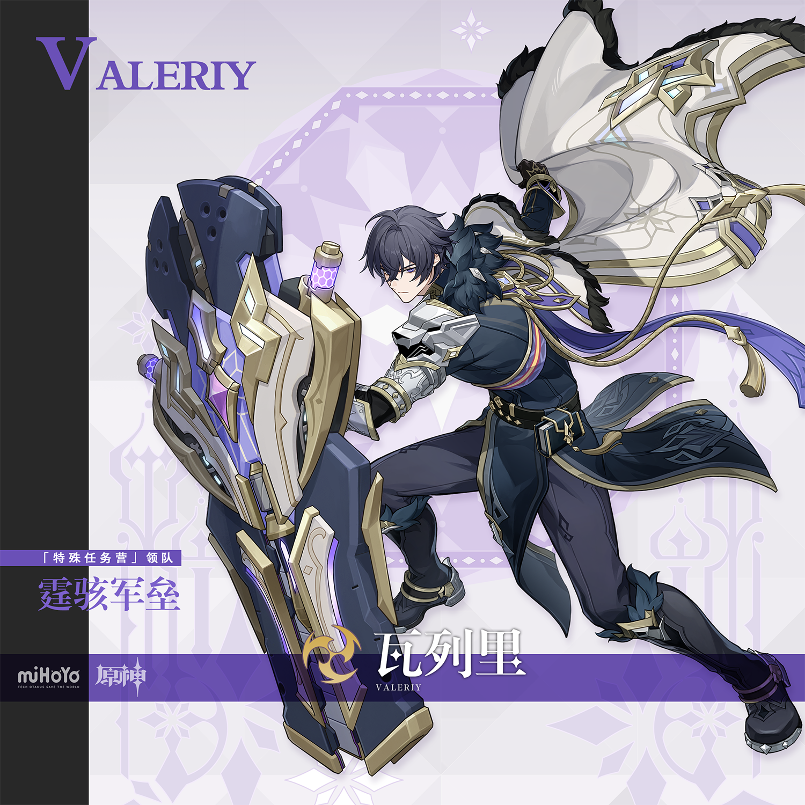
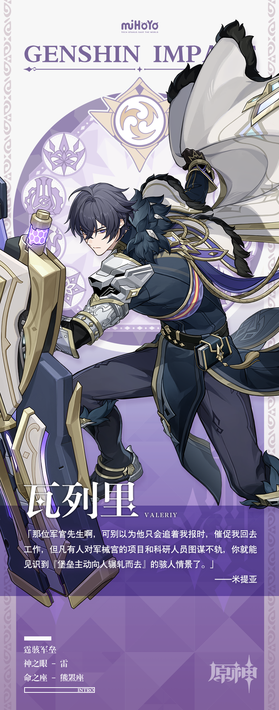

# 谨律时度，严慎争守

军械宫，格鲁波夫内部庞大的研究设计与生产复合体。作为雪国最为重要的科研机构，它孕育了诸多尖端技术与中坚兵器，持有的机密和贵重资产不可计量。

为了保证军械宫与相关人员的安全，第一掷弹兵团的精锐被重新编组为「特殊任务营」，担任该机构的直属卫队。这支精锐部队的指挥官便是瓦列里少校。

瓦列里少校的履历尤为闪耀，他曾率部剿灭六组地脉异动的魔物集群，捣毁三个穷凶极恶的兽怪匪帮，还肃清了至冬堡西面八成以上的暴走合成魔兽…

同时，无需副官协助，他就能精准地安排全营的工作，日复一日，年复一年，从未出错。

有这种战斗和管理的双重专家坐镇卫队，军械宫的专家们便可心安神泰，专注于科研与生产工作。

的确，「特殊任务营」就位后，匪帮残党窃取军械宫情报的计划，亡命之徒绑架科研人员的企图…九十余组特性截然不同的威胁，都被瓦列里少校率部挫败。

不过，近年来，有军事观察家惊奇地发现，瓦列里少校开始频繁出入科洛列夫茨基剧院和老庭院餐厅等日常休闲的场所…

对于一切猜测和揣度，瓦列里少校都不予置评，而是继续用完美的时间规划与滴水不漏的工作安排作为回应。

人当然不是机器，不能完全变成齿轮，每时每刻都严格按照时间表运转。但科学的排期是一种保障，为的是在计划遭遇意外时，有着灵活应对的空间与底气。

总有一些工作需要应急方案；总有一些死线，无论如何都不能被跨越。

总有一些人要承受压力，时刻跟进工作计划，阻绝宕延和意外。