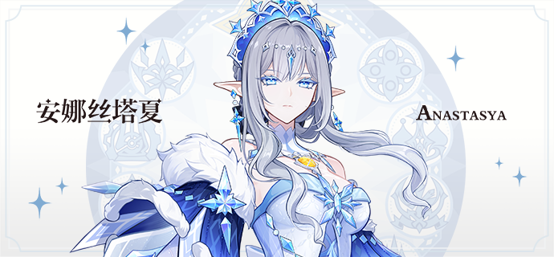
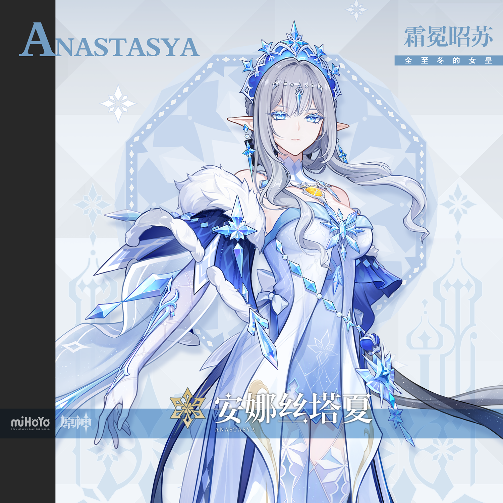
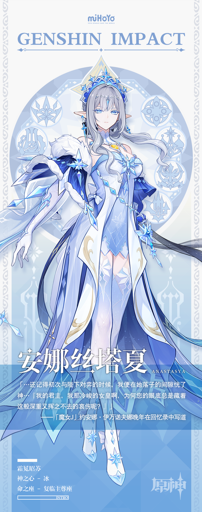

# 裁雪辟夜，澄晓终明

关于女皇的过去——

安娜丝塔夏是于冰霜之中诞生的精灵。

追随莫诺马赫并加入苍星王廷的那段时间，曾如至冬的极光般温柔而美好，却也会在某一日的清晨如极光般隐去，再也捉摸不见。

被天理复活后的安娜丝塔夏曾于风雪中徘徊数百年，追寻那些失去的往昔，试图参透这世间种种残酷的奥秘。

她如此清楚地认识到，就连自己的情感和心意都不过是可以被随意操控的工具罢了。

于是，等她能够确认「至少曾经的自己一定深刻地理解并感受过爱」之后，便停下了找寻的脚步。

这样便已经足够了。

关于女皇的现在——

她不信任自己的记忆，不相信自己的感情。可这份怀疑，会让一位君王失去该有的果决。

她理应为过去的遭遇感到愤恨，理应去报偿过去的仇怨。可这份怒火，会让一位君王失去该有的理性。

于是她抛弃了自己的过往，选择只活在当下。

安娜丝塔夏无时无刻不在凝视着悬在众人头顶的那柄利剑。总有人要这样做，必须有人要这样做。

为了眼下的至冬，乃至整个世界，她要时刻以苍星的名义，做出最正确的决断。

那些决断时而冷酷，时而凌厉。

可那些仍旧选择亲近她的子民们，总是能够洞穿其中温柔的底色。

关于女皇的未来——

将杀并非终点。

她知道，在天理面前，我方的「王」与普通棋子无异。

如若有一天，「弃子」成为必要的战术…

「既已以身入局，成败之外，别无归途。」