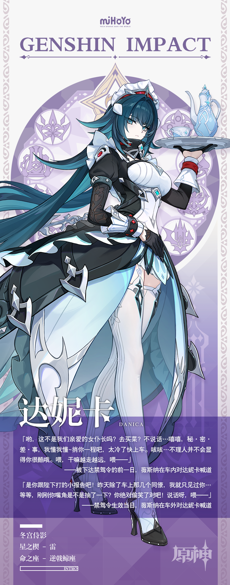

# 仪轨无缺，静影藏锋

作为别捷尼茨卡娅家族的第三代宫廷女仆，达妮卡将这份职业做到了极致。她像钟表一样精准，如阴影一样沉默，在无声处维持着整座宫殿的绝对整洁与秩序。

但若你以为她不过是一位比寻常女仆更擅长家政内务的能手，那便失之偏颇了。

必要时，作为女皇陛下最忠诚的近侍，达妮卡亦是游走于各方势力间的隐形枢纽。传达陛下的旨意，在暗流涌动中调停各方的利益冲突。当政要们的谈判陷入僵局，她适时端上一杯温度恰到好处的红茶，瓷盏落在桌面的轻响，往往是一记恰到好处的暗示——它含蓄地提醒在座的诸位：女皇陛下的注视从未离开。

几乎没人敢轻视这位年轻的人类女性。她曾是执行官「队长」的亲传弟子，也曾以佣兵身份游历诸国。那身优雅得体的女仆装下，隐藏着远超凡人的爆发力与意志力…既能轻柔地拂去名画上的灰尘，也能以处刑者般的决绝，迅捷地扫除挡在女皇前路上的一切障碍。

正因如此，平日里不苟言笑、惜字如金的达妮卡，身上总萦绕着一股难以言喻的压迫感。尤其是当她面部肌肉紧绷、眼神骤然微沉时，周遭的空气仿佛都会随之降至冰点，令人不自觉地屏息噤声。 

不过，只有极少数与她相熟的友人清楚，女仆长大人此刻未必是在动怒，也可能只是恰巧听到了一句并不怎么高明的笑话，正拼尽全力地绷紧脸颊，好让自己别在严肃的场合里笑出声罢了。